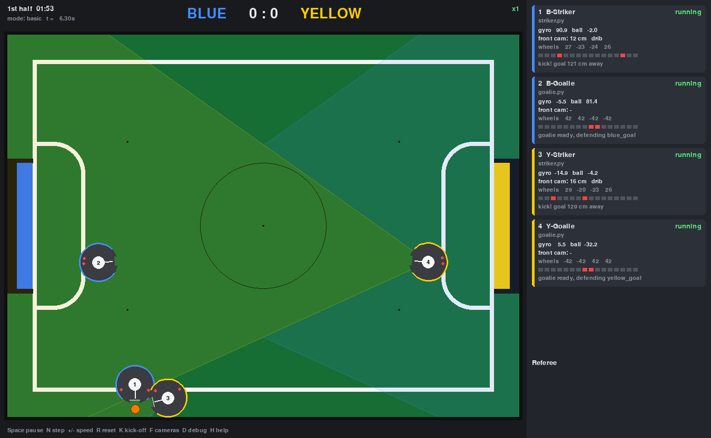

# RoboCupJunior Soccer Simulator

A 2D top-down simulator for **RoboCupJunior Soccer**. You write robot programs in Python
with the `rcj_sim` library and choose which robots play. Several robots can run the same
file. You watch the match live in a pygame window, and an automatic referee
enforces the official rules.



## Setup

```bash
python3 -m venv .venv
.venv/bin/pip install -r requirements.txt
```

## Run a match

```bash
.venv/bin/python -m rcj_sim examples/match.yaml
```

Quick form without a config file. `--blue` / `--yellow` take one program per robot:

```bash
.venv/bin/python -m rcj_sim --mode free --blue examples/striker.py examples/goalie.py --yellow examples/striker.py
```

Other options:

| Option | Meaning |
|---|---|
| `--mode free\|basic\|full` | referee mode (see below) |
| `--half 120` | half duration in seconds (official: 600) |
| `--noise` | sensor noise + gyro drift |
| `--headless --duration 120` | no window, as fast as possible, prints the result |
| `--screenshot shot.png --duration 3` | save one frame and exit |
| `--scale 3` | pixels per cm (default: fit the screen) |
| `--quiet` | don't echo robot `print()`s to the console |

### Window controls

| Key / mouse | Action |
|---|---|
| Space | pause / resume |
| N | single step (50 ms) |
| + / − | simulation speed ×0.25 … ×8 |
| R | reset the match (restarts all robot programs) |
| K | kick-off now |
| F | show the front-camera field of view |
| D | debug: ball trail and all 16 line sensors |
| H | help |
| drag | move the ball or a robot |
| mouse wheel over a robot | rotate it |
| right-click a robot / its card | remove as *damaged* / put back |

## Match configuration (`match.yaml`)

```yaml
mode: basic                 # free | basic | full
referee:
  half_duration_s: 600
  first_kickoff: blue
sim:
  noise: false
  occlusion: false          # robots can hide the ball / goals from the cameras
  accel_limit: false        # realistic motor acceleration
robots:
  - name: B-Striker
    team: blue              # team = goal it defends in the 1st half
    code: striker.py        # same file can be used by several robots
  - name: Y-Striker
    team: yellow
    code: striker.py
    enabled: false          # leave a robot out
    start: {x: 45, y: 0, heading: 0}   # optional kick-off spot; heading 0 = facing opponent goal
```

All `sim:` options (defaults in [rcj_sim/config.py](rcj_sim/config.py)):
`physics_hz, seed, max_wheel_speed, accel_limit, max_accel, kick_speed, kick_cooldown,
dribbler_grip, ball_decel, front_fov_deg, front_range_cm, occlusion, noise, angle_noise_deg,
distance_noise_pct, gyro_noise_deg, gyro_drift_deg_per_min, api_call_cost_ms, watchdog_s`.

All `referee:` options: `mode, half_duration_s, halves, swap_sides, first_kickoff, goal_hold_s,
out_of_bounds, out_of_bounds_penalty_s, multiple_defense, lack_of_progress, lack_of_progress_s,
lack_of_progress_cm, max_robots_per_team`.

## Writing a robot program

A robot program is a Python file with a `main(robot)` function. Write it like code for a
real robot: an endless loop with `robot.delay()`.

```python
from rcj_sim import BALL, BLUE_GOAL, YELLOW_GOAL

def on_line(sensor):                 # interrupt: line sensor 0..15 touched a white line
    print("line on sensor", sensor)

def main(robot):
    robot.set_interrupt(on_line)
    robot.set_dribbler(True)
    while True:
        a = robot.get_object_angle(BALL)          # 360° camera, always available
        robot.set_speed(0, 80, a * 3)             # forward 80 cm/s, turn towards the ball
        if robot.has_ball():
            robot.kick()
        robot.delay(10)
```

### Conventions

* Distances are in **cm**, speeds in **cm/s**, angles in **degrees**.
* Every angle is in (−180, 180]. **0 = straight ahead, positive = clockwise (to the right).**
* Use `robot.opponent_goal` / `robot.my_goal` instead of a fixed colour, so the same
  program works for both teams and after the half-time side swap.

### API

| Function | Description |
|---|---|
| `set_speed(vx, vy, omega)` | Drive the **X-shaped omni wheels**. `vx` = right, `vy` = forward (cm/s), `omega` = deg/s clockwise. If a wheel would exceed `max_wheel_speed` (120 cm/s), all wheels are scaled down together, keeping the direction. Top speed straight ahead ≈ 170 cm/s. |
| `motor_stop()` | Stop all four drive motors. |
| `get_angle()` | **Gyro** heading relative to the heading at program start (`reset_angle()` re-zeros it). Positive = turned clockwise. |
| `get_object_angle(obj)` | **360° camera**: angle to `BALL`, `BLUE_GOAL` or `YELLOW_GOAL` from anywhere on the field. `None` only if hidden (occlusion option). |
| `get_object_location(obj)` | **Front camera**: `(distance_cm, angle)` if the object is inside the forward field of view (default ±30°, 250 cm), else `None`. A goal counts as seen if part of its mouth is in view; the result points at the centre of the visible part. |
| `set_interrupt(func)` | Register `func(sensor)` or `func(robot, sensor)`. It runs when one of the **16 line sensors** moves onto a white line. Sensor 0 is at the front and indices increase clockwise every 22.5° (4 = right, 8 = back, 12 = left). The interrupt runs immediately, even in the middle of `delay()`. `None` removes it. |
| `get_line_sensors()` | List of 16 booleans (True = on a white line). |
| `line_sensor_angle(i)` | Mounting angle of sensor `i`, degrees clockwise from the front. |
| `set_dribbler(on)` / `dribbler_on()` / `dribbler_off()` | The dribbler holds a ball that enters the front notch (≤ 1.5 cm inside the robot, as the rules allow). It keeps holding while you drive and turn, and a hard hit can knock the ball out. |
| `kick()` | Kicks the ball forward at 300 cm/s if it is in the notch. That is strong enough to cross the whole field, and passes the rules' kicker power check. Needs 0.5 s to recharge. Returns `True` if the ball was kicked. |
| `has_ball()` | Ball is in the front notch (light-gate sensor). |
| `delay(ms)` | Sleep in **simulation** time. |
| `millis()` | Simulation time in ms. |
| `set_wheel_speeds(fr, fl, bl, br)` / `get_wheel_speeds()` | Low-level wheel access (cm/s). |
| `name`, `team`, `my_goal`, `opponent_goal` | Robot identity / goals. |
| `print(...)` / `log(...)` | Shown in the robot's card and the console, prefixed with the robot name. |

### How robot code is run

* Each robot runs in its own thread, but in **lockstep with simulation time**. `delay(ms)`
  advances the robot's clock, and every other API call costs 0.1 ms of simulated CPU time.
  So a loop without `delay()` still works, and the same seed always gives the same match.
* If a program crashes, its traceback is shown in red on its card and in the console, and its motors stop.
* If a program loops for 2 real seconds without calling the robot API, it is marked
  **hung**.
* A program can import helper modules from its own folder. Each robot gets its *own copy*
  of the main file, so module-level globals are not shared between robots.
* At half time, robot programs are restarted (like rebooting the robot) and the gyro is
  re-zeroed facing the new opponent goal.

## Robot model

| Part | Simulated as |
|---|---|
| Body | Ø 18 cm, 18 cm high, 1.2 kg, round, with a 1.5 cm × 4.6 cm ball notch at the front |
| Drive | 4 omni wheels at 45°/135°/225°/315° (X shape), 7 cm from the centre |
| 360° camera | angle to ball / goal centres, any distance |
| Front camera | distance + angle, ±30° FOV, 250 cm range (configurable) |
| Dribbler | holds the ball in the notch |
| Kicker | 300 cm/s, 0.5 s recharge |
| Line sensors | 16 TCRT on a 7 cm ring, interrupt on reaching a white line |
| Gyro | heading, optional noise + drift |

## Field and rules (RoboCupJunior Soccer 2026)

The robot size (Ø 18 cm) is the **Soccer Vision** league limit, so its ball (orange golf ball,
Ø 42.7 mm) is used. All dimensions are in [rcj_sim/constants.py](rcj_sim/constants.py):

* Playing field 219 × 158 cm, with a 2 cm white line (part of the field). There is a 12 cm outer area, so the walls enclose 243 × 182 cm.
* Goals are 60 cm wide, 7.4 cm deep and 10 cm high, one blue and one yellow, with the posts over the white line.
* Penalty areas are 80 × 25 cm with 15 cm rounded front corners. The centre circle is Ø 60 cm. There are 5 neutral spots: the centre plus four spots 45 cm from the short edges, in line with the penalty-area sides.
* A goal counts when the ball touches the back wall of the goal.

### Referee modes

| Mode | What the referee does |
|---|---|
| `free` | No clock, no penalties. The match ends at the **first goal**. R starts again. |
| `basic` | Score and a clock with 2 halves. Kick-off after each goal goes to the team scored against, with opponents ≥ 30 cm from the ball outside the centre circle. Sides swap at half time. **Lack of progress**: if the ball moves less than 3 cm in 5 s, it goes to the nearest unoccupied neutral spot. |
| `full` | `basic` plus the following. **Out of bounds**: a robot touching a wall or *completely* inside a penalty area is removed for 1 minute (a kick-off ends the penalty early). It returns on the unoccupied neutral spot furthest from the ball, facing its own goal. **Multiple defense**: if two robots of a team are partly in their own penalty area, the one farther from the ball moves to a neutral spot. Max 2 robots per team. |

Every rule can be switched off in the `referee:` section.

Sources: [rules](https://robocup-junior.github.io/soccer-rules/master/rules.html) ·
[field specification](https://robocup-junior.github.io/soccer-rules/master/field_specification.html) ·
[ball specification](https://robocup-junior.github.io/soccer-rules/master/ball_specification.pdf)

## Examples

* [examples/striker.py](examples/striker.py): turns to the ball, catches it with the dribbler, turns to the goal and kicks. It backs off lines with an interrupt.
* [examples/goalie.py](examples/goalie.py): rides the front line of its own penalty area by polling the line sensors, and tracks the ball sideways.
* [examples/line_test.py](examples/line_test.py): line interrupt demo.

## Running existing robot code (Superstrika)

[superstrika/](superstrika/README.md) runs the Superstrika team's real `hunter.py` unchanged,
on simulated motors, gyro, servo-tilted camera and dribbler:

```bash
.venv/bin/python -m rcj_sim superstrika/match.yaml
```

## Tests

```bash
.venv/bin/python -m pytest
```

## Project layout

```
rcj_sim/
  constants.py   official dimensions
  field.py       lines, penalty areas, goals, neutral spots
  physics.py     pymunk world, robot body, dribbler, kicker
  hardware.py    omni kinematics, gyro, cameras, line sensors
  api.py         the Robot class your code uses
  runner.py      runs robot code in time-locked threads
  referee.py     free / basic / full rules
  sim.py         simulation loop
  render.py      pygame window
  config.py      YAML / CLI configuration
examples/        sample robots and match.yaml
tests/           pytest suite
```
