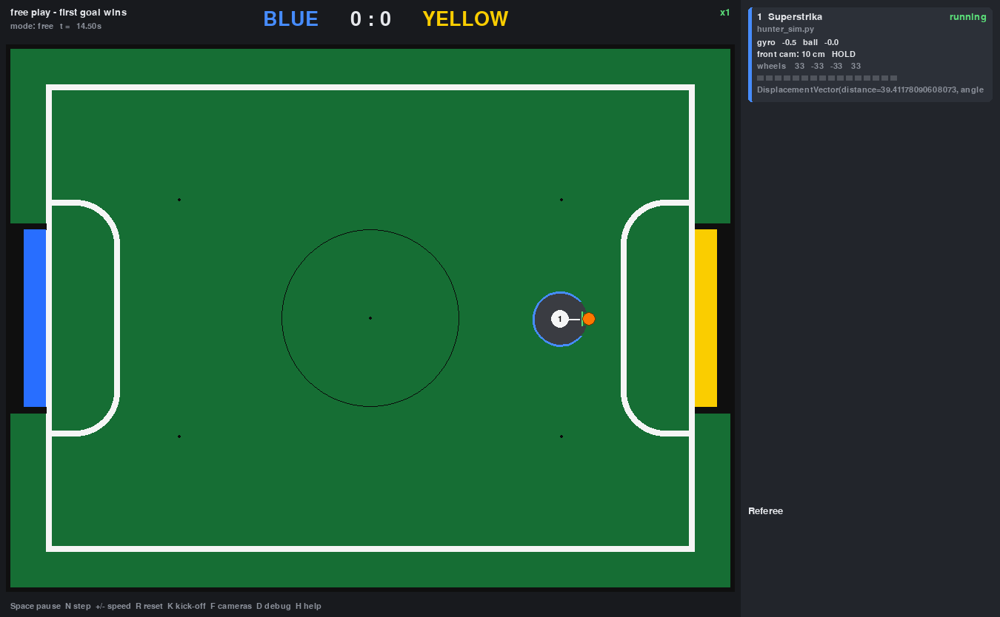

# Superstrika in the simulator

This folder runs Superstrika's **real robot code** (`robot/hunter.py` → `Hunt.hunt()`) inside
the RoboCupJunior simulator. Their files are imported **unchanged** from the Superstrika
repository. Only the hardware layer underneath them is simulated.



## Run

```bash
.venv/bin/python -m rcj_sim superstrika/match.yaml
```

By default the bridge finds the robot code in `../Superstrika-new`, next to this repository.
To use another checkout, set `SUPERSTRIKA_PATH`:

```bash
SUPERSTRIKA_PATH=/path/to/Superstrika-new .venv/bin/python -m rcj_sim superstrika/match.yaml
```

Their `hunter.py` logging goes to `logs/superstrika.log`, and the robot card shows the last
`print()`. To play against the example goalie, set `enabled: true` on `Y-Goalie` in
[match.yaml](match.yaml).

## What is real and what is simulated

| Robot code | In the simulator |
|---|---|
| `hunter.py`, `pidCalc.py`, `gyroMovement.py`, `multipleMotors.py`, `servo.py`, `dribbler.py`, `kicker.py`, `ICamera.getObjectsStatus`, `enum.py`, `data.py` | **real code, unchanged** |
| `gpiozero` (`PWMLED`, `Button`, `DigitalOutputDevice`), `smbus2` | fake modules. The servo angle is decoded from its PWM duty, and the kicker pin fires `kick()` |
| `robot.components.motor.motor7046` | `speed` (−100…100 %) drives the matching simulated X omni wheel, identified by pin pair |
| `robot.components.gyro.MPU6050` | `get_z_angle()` comes from the simulated robot (unwrapped, counter-clockwise +) |
| `WebCamera` (YOLO) | `SimWebCamera`: a 60° camera on the tilt servo, 14.5 cm high, returning `DisplacementVector(distance, angle)` like the real one |
| `time.time()` / `time.sleep()` | simulation time, only inside the robot's thread. So `PidCalc`, `sleep(0.3)`, the servo's 0.5 s settle and so on all take sim time |

`hunter.py` currently has `self.camera = ...` commented out, so the bridge attaches the
simulated camera after `Hunt()` is created. If you un-comment that line, the simulated
`WebCamera` is used directly.

Their wheel mixing in `multipleMotors.setSpeed` (FR, RR, RL, FL with positive rotation =
counter-clockwise) matches the simulator's X layout one to one. No sign changes were needed.

## Assumptions to calibrate

The code alone does not give these numbers. They are in `SETTINGS` in
[superstrika_bridge.py](superstrika_bridge.py):

| Setting | Value | Where it comes from |
|---|---|---|
| `wheel_cm_s_per_percent` | 0.667 | `move_forward_cm` assumes 0.05 s per cm at `setSpeed(0, 30)`, which works out to 20 cm/s. Tested. |
| `motor_deadband_percent` | 0 | real motors probably need ~`motor7046.MIN_SPEED` = 30 % to turn |
| `camera_offset_cm` | 9 | camera at the front edge |
| `camera_hfov_deg` / `camera_vfov_deg` | 60 / 45 | typical webcam |
| `servo_horizon_angle`, `servo_pitch_per_deg` | 180, 0.5 | servo 180 looks straight ahead, and 40 looks 70° down |
| `camera_frame_ms` | 100 | one frame plus YOLO inference on the Pi |

## What the simulator shows about `hunter.py`

These come from running the unchanged code:

1. **The robot never pushes the ball into the goal.** `goToBall()` sets the forward speed
   with a PID on the distance, so the speed goes to 0 as the robot reaches the goal *mouth*.
   A goal only counts when the ball touches the *back wall*, 7.4 cm further in. The robot
   stops at the mouth, loses sight of the goal because it is too close for the camera, and
   then `spinSearch` spins in place forever. The same PID also makes the last few cm to the
   ball very slow: about 3 % motor speed at 3 cm.
2. **`goToBall()` only returns when the object disappears from the camera.** While the
   ball or goal is visible it keeps looping. So `IN_KICKER` and `GoalStatus.CLOSE` are only
   checked after the camera loses the object.
3. **The kicker is never used.** The "Kicked Ball!!!!!" branch calls
   `dribbler.counterStart()`, which sets the same +100 % as `start()`.
4. **Crashes waiting in the code:**
   * `self.vcnl` does not exist, and `getObjectsStatus()` takes no argument (line 223). Reaching `GoalStatus.CLOSE` in `hunt()` raises `AttributeError`.
   * `self.camera` is commented out in `__init__`, so on the real robot `hunt()` / `goToBall()` raise `AttributeError` right away.
5. **Always attacks the yellow goal:**
   `Object.YellowGoal if data.SELF_IS_BLUE else Object.YellowGoal` (line 205) has the same goal in both branches.
6. **Searching is slow.** Each `camSearch()` takes about 3 s: 4 servo moves × (0.5 s `setAngle`
   sleep + 0.2 s + 1 frame). One full `spinSearch()` circle takes about 25 s.
7. **Dead code in `tryBallDownSearch()`.** `range(MAX_ANGLE, MIN_ANGLE, -20)` stops at 60, so the
   `angle <= MIN_ANGLE` branch never runs.
8. `goToGoal()` turns by `-error.distance` instead of the angle. It is not called at the moment.

## Limitations

* All robots that run `hunter_sim.py` share one copy of the Superstrika modules, so module
  globals such as `data.SELF_IS_BLUE` are shared between them.
* Threads that the robot code starts itself, such as `EdgeLineDetection`'s escape thread,
  are not time-locked to the simulation. `EdgeLineDetection` is disabled in `hunter.py`
  today. The start button is never pressed.
